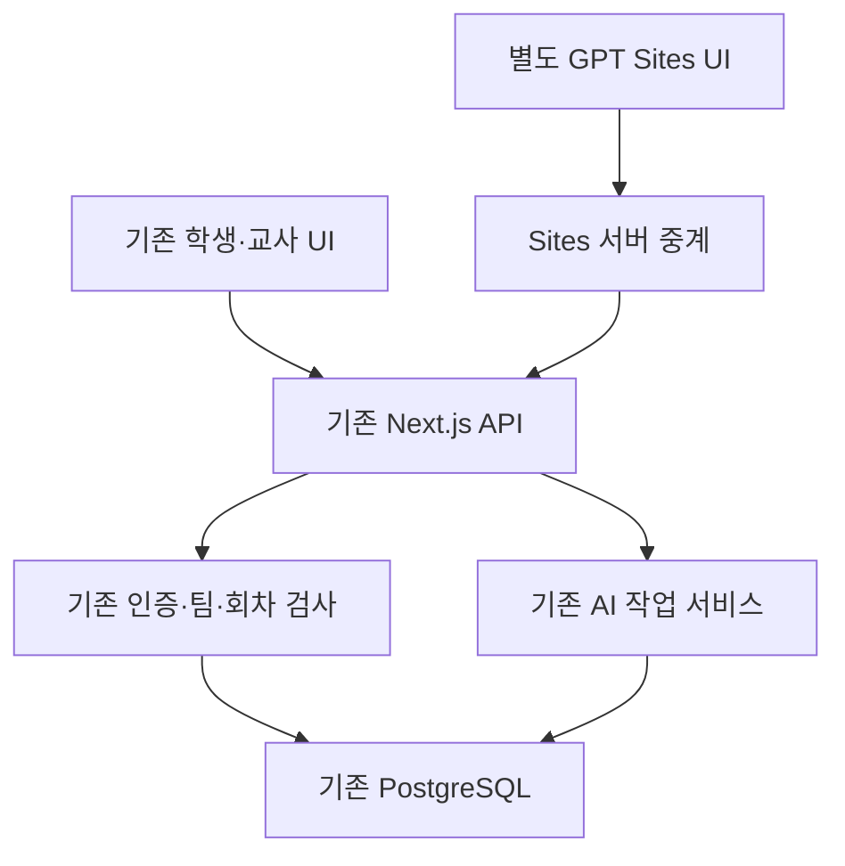

# GPT Sites 학생 UI 실험판 조사 및 구현 · 2026-10-05

원본 기준은 `bf456bceae36186f1a0fb7e408776361506c7689`입니다. 이 작업은 기존 운영을 보존하고 별도 프론트를 추가합니다. Cloud Run production, PostgreSQL 데이터/마이그레이션, 학생 계정, 기존 AI 호출은 변경하지 않았습니다.

## 확인한 구조

| 영역 | 실제 저장소 |
|---|---|
| Frontend | Next.js 16.3.3 App Router + React 19.2.8, 학생/교사 UI |
| Backend | 같은 Next 앱의 Route Handlers와 src/lib 서비스, Node 런타임 |
| Database | PostgreSQL, Cloud SQL Unix socket 또는 DATABASE_URL. 운영에서 메모리 DB 사용 금지 |
| Authentication | bcrypt 비밀번호, HS256 서명 JWT, HttpOnly science_inquiry_session, 세션 버전·활성 계정·학년도 검사 |
| AI | 서버 OpenAI SDK 7.5.0, 기능별 Luna/Terra/Sol 등 설정, 웹검색 옵션·개인정보 마스킹 |
| File Storage | 학생 활동 사진 PostgreSQL BYTEA. 교사 시험 PDF는 서버 생성. 학생 AI PDF 첨부 API는 없음 |
| Usage | openai_usage 구조화 서버 로그, AI 작업 예약·멱등 결과 DB. 비용 원장/학생 크레딧은 확인 안 됨 |
| Credit | 학생별 AI 크레딧·초기화·차감, 월 $25 총액 상한을 코드/스키마에서 확인하지 못함 |
| Deployment | Docker + Cloud Build + Cloud Run, Cloud SQL. 과거 최신 배포 문서 revision 00045-hic |

현재 실서버 URL은 https://science-inquiry-platform-974188506094.asia-northeast3.run.app 입니다. `/api/health`의 DB SELECT 1 응답이 200인 것을 이번에 확인했습니다. GCP 콘솔의 현재 리비전·트래픽·백업·DB 크기·계정별 사용량은 이번 연결 권한으로 조회하지 않았습니다. 역사적 배포 정보를 현재 실시간 상태로 단정하지 않습니다.

## 추가한 범위

- `/api/sites/session`: opt-in 최소 프로필 조회. 비밀정보/로그인 ID를 출력하지 않고 비용 기능의 미확인 상태를 명시합니다.
- `/api/sites/teacher-summary`: 기존 교사 대시보드의 일반 교과 계정 범위만 반환합니다. 학생은 403, 최초 비밀번호 변경 계정도 403. 관리자 쓰기 기능이 아닙니다.
- 두 API는 `SITES_PILOT_ENABLED=true`일 때만 작동하며 기본 404입니다. **production에 배포하지 않았습니다.**
- `experiments/sites-student-ui`: 실제 Sites에 게시한 UI 소스 사본. 별도 Worker이며 Sites D1/R2 바인딩이 없습니다.
- 학생 로그인·홈·주제·질문·고정 코칭·대화·계획서·일지·제출 흐름을 합성 데이터로 제공합니다. 학생 데이터는 기존 서버를 사용하도록 API 중계를 구현했습니다.

별도 비공개 사이트: https://science-inquiry-backend-pilot.qhcjf2.chatgpt.site

Sites 배포의 production은 **새 실험판 사이트의 게시**를 뜻합니다. 기존 Cloud Run production 배포가 아닙니다. 현재는 소유자 전용 접근을 유지합니다. 이 단계에서 실제 학생에게 링크를 열지 않았습니다.

## 연결 상태를 구분

| 항목 | 상태 |
|---|---|
| 기존 서버 health GET | 직접 HTTP 및 게시된 Sites 중계 모두 200 확인 |
| 새 UI 중계와 기존 세션 쿠키 | 구현, 합성 보안 검사 통과 |
| 새 프로필/교사 API | GitHub 실험 브랜치에 추가. production 미반영 |
| 실제 학생 로그인→DB 저장 왕복 | 별도 staging 서버와 합성 계정 검증 필요 |
| 유료 AI | 중계 서버에서 항상 423 잠금. API 키 없음 |
| PDF 분석/세 가지 모드 | 원본 대상 API에 없음. 사용 불가로 표시 |
| 운영 데이터 복제 | 수행하지 않음 |

## 검증

- 기존 저장소와 새 API: TypeScript 통과, 전체 112파일 **612검사 통과**, Next 프로덕션 빌드 통과.
- 첫 전체 검사에서 시험 PDF 한글 글꼴 경로가 없어 2개 실패했습니다. 코드 변경 없이 PDF_FONT_PATH로 글꼴을 제공한 뒤 해당 6검사와 전체 612검사가 통과했습니다. 시험 서비스/시험 테스트 원본 파일 해시가 HEAD와 동일합니다.
- Sites UI: TypeScript, Vinext Worker 빌드, 중계 보안/크기/권한, 실제 Worker SSR·글꼴·쓰기 차단 검사를 통과했습니다. 게시된 Sites에서 bridge-status 200 / health 200 / 비로그인 inquiry 403 / 운영 login 423을 확인했습니다. 로컬 Worker의 외부 health는 실행 환경 DNS 제한으로 502였으나 게시된 사이트의 중계는 200이었습니다.
- 동시 요청은 합성 fetch 60개만 시험했습니다. 진행 8개, 52개 429, 슬롯 반환 후 재요청 정상입니다. 이것을 Cloud Run 60명 또는 전체 300명 실사용 부하 검증으로 해석하지 않습니다.
- Sites/실기기 브라우저와 WebMCP 지원 환경 검증은 사용 가능한 허용 브라우저 제어가 없어 미실시입니다. 화면 흐름의 실제 클릭 QA는 다음 교사 확인 단계에 남습니다.

## 확장 전 조건

`docs/SITES_API_CONTRACT.md`, `docs/300_USER_REVIEW.md`를 따릅니다. 기존 DB와 계정을 보존한 독립 staging을 마련한 다음 5–10명, 한 반, 전체 순으로 진행합니다. 기존 안정적인 프론트를 계속 제공하고 운영 원본 DB를 초기화하지 않습니다.

게시 버전 2 / 소스 commit d72155b79ce0d77333b48bae01caf67407963f53 / 별도 Sites deployment appgdep_6ac3c1eb792881918cafa76e2dfc0aae 성공.

## GitHub 문서 공개 범위

자동 승인 검토에서 기존 PROJECT_STATUS의 실명·비공개 시트 주소·자격증명 파일 참조를 포함한 업로드가 거부됐습니다. 현재 상태 문서를 이번 구현의 안전한 요약으로 정리하여 민감한 과거 내용을 새 변경본에서 제외했습니다. Git 이력과 실제 학생 DB/기록은 유지합니다.
